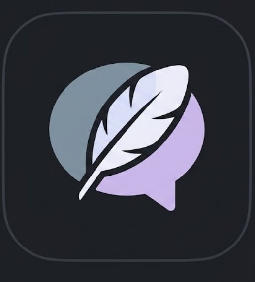

# Lowcord
Lightweight Android WebView client for Discord built with Kotlin. Features persistent sessions, WebRTC voice support, file uploads, and dark/light theming.

  

  # Lowcord

  **A lightweight, fast Android WebView client for Discord built with Kotlin.**

  
  
  
  

  [Features](#-features) • [Comparison](#-why-lowcord) • [Installation](#-installation) • [Tech Stack](#-tech-stack)

---

## ✨ Overview

**Lowcord** wraps the web client in a finely tuned native Android container. It is built for devices where the official Discord app feels heavy, slow to launch, or drains excessive RAM and battery, while preserving voice channels, media uploads, and persistent logins.

## ⚡ Why Lowcord?

| Metric / Feature | Official Discord App | Lowcord |
| :--- | :---: | :---: |
| **APK Size** | ~100+ MB | **~2–4 MB** |
| **RAM Footprint** | High (heavy background services) | **Low (WebView engine)** |
| **Startup Speed** | Heavy splash & asset loading | **Instant launch** |
| **Voice Chat (WebRTC)** | ✅ Supported | ✅ **Supported** |
| **File & Image Uploads** | ✅ Supported | ✅ **Supported** |
| **Persistent Login** | ✅ Supported | ✅ **Supported** |

## 🚀 Features

- **Persistent Sessions & Caching:** Full `CookieManager` and DOM storage integration keeps you logged in across app restarts and speeds up repeat loads.
- **WebRTC Voice Support:** Handles runtime `RECORD_AUDIO` permissions and WebRTC audio streams (`onPermissionRequest`) so voice channels work out of the box.
- **Native File Picker:** Integrates Android's system file chooser (`onShowFileChooser`) for attaching images, videos, and documents.
- **Adaptive Dark & Light Themes:** Seamlessly matches your device's system theme without jarring white flashes on startup.
- **Desktop / Mobile Viewport Control:** Tuned `User-Agent` and WebView settings for smooth scrolling and clean UI scaling.

## 📥 Installation

1. Go to the **[Releases](https://github.com/Snowsniw371/Lowcord/releases/latest)** page.
2. Download the latest signed **`app-release.apk`** from the **Assets** section.
3. Open the downloaded file on your Android device and allow installation from your browser/file manager if prompted.

> [!NOTE]
> Minimum supported version is **Android 7.0 Nougat (API 24)**. Make sure **Android System WebView** is up to date via Google Play for the best WebRTC and rendering performance.

## 🛠️ Tech Stack

<b>Click to expand architecture & permissions details</b>

- **Language:** Kotlin
- **Core Components:** `android.webkit.WebView`, `WebChromeClient`, `WebViewClient`, `CookieManager`
- **Declared Permissions:**
  - `INTERNET` & `ACCESS_NETWORK_STATE` — Core connectivity and caching checks.
  - `RECORD_AUDIO` & `MODIFY_AUDIO_SETTINGS` — Voice channel microphone input via WebRTC.
- **Build Environment:** Developed, compiled, and signed entirely on Android using **Code on the Go**.

## 📄 License

Distributed under the **MIT License**. See [LICENSE](LICENSE) for more details.
